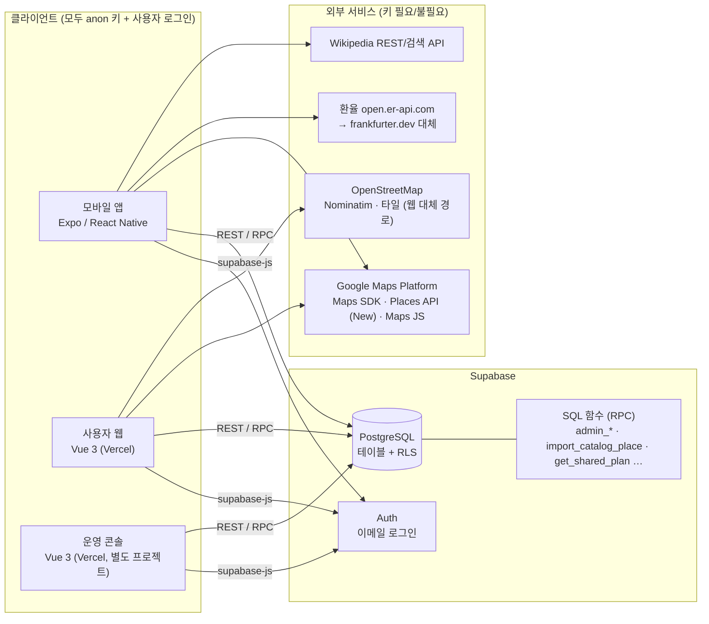
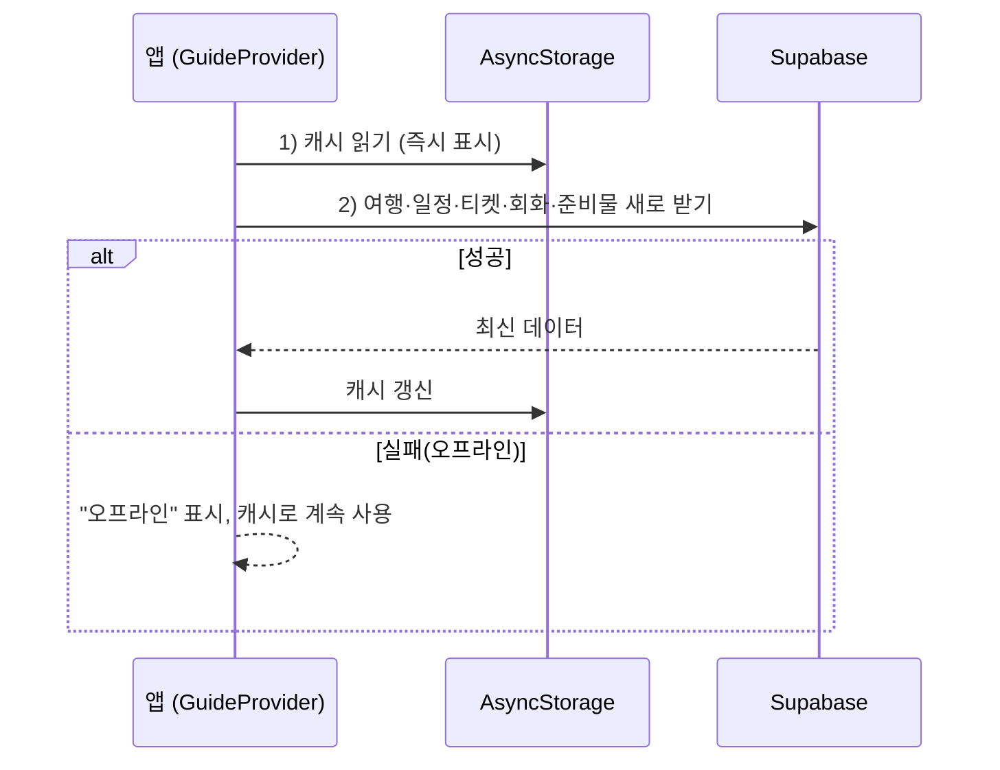
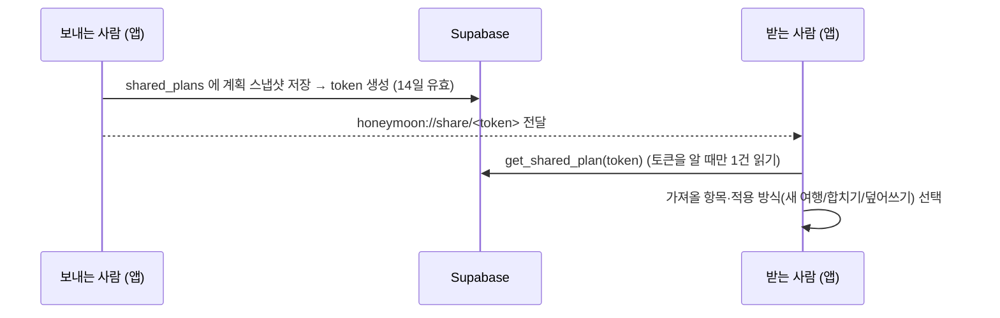

# 01. 시스템 아키텍처

> 대상 독자: 개발자·운영자 · 최종 갱신: 2026-11-13
> 짝 문서: [02 데이터베이스 설계](02-데이터베이스-설계.md) · [03 소스 설명](03-소스-설명.md) · [04 운영 매뉴얼](04-운영-매뉴얼.md) · [05 사용자 매뉴얼](05-사용자-매뉴얼.md) · [배포 가이드](배포-가이드.md)

## 1. 한눈에 보기

**Honeymoon Guide** 는 나라에 상관없이 쓸 수 있는 **개인용 여행 준비·여행 중 가이드**입니다.
일정·티켓(바우처)·회화·준비물을 준비하고, 여행 중에는 모바일 앱에서 오프라인으로 보며 메모·사진·지도를 남깁니다.

| 구성 요소 | 폴더 | 기술 | 누가 쓰나 | 역할 |
|-----------|------|------|-----------|------|
| 모바일 앱 | `mobile/` | Expo 58 · React Native 0.88 · React 19 | 여행자 | 여행 중 사용 (일정·지도·기록·환율·회화·공유) |
| 사용자 웹 | `web/` | Vue 3 · Vite | 여행자 | PC에서 여행 계획·장소·티켓·회화·준비물을 편하게 입력 |
| 운영 콘솔 | `admin/` | Vue 3 · Vite | 운영자 | 가입자·접속·인사이트·사용자 관리·추천 관광지 관리 |
| 데이터베이스 | `supabase/` | Supabase(PostgreSQL) | — | 데이터 저장, 로그인, 접근 제어(RLS), 운영 함수 |
| (보관) 예전 서버 | `backend/` | Spring Boot 3.3 · H2 | — | **더 이상 사용하지 않음.** 데이터 이전 스크립트용으로만 보관 |

별도의 자체 API 서버는 없습니다. **앱·웹·콘솔이 Supabase 를 직접 호출**하고, 접근 제어는 DB 의 행 단위 보안(RLS)과 SQL 함수가 맡습니다.

## 2. 전체 구성도



### 2-1. 구성 원칙

1. **서버리스**: 별도 서버 없음. 배포 대상은 정적 웹 2개(Vercel)와 APK(EAS Build)뿐입니다.
2. **anon 키만 사용**: `service_role` 키는 어디에도 넣지 않습니다. 관리자 기능은 `SECURITY DEFINER` 함수(`admin_*`)로만 동작합니다.
3. **본인 데이터만 접근**: 모든 사용자 테이블에 `owner_id = auth.uid()` RLS 가 걸려 있습니다. 관리자도 다른 사용자의 **내용**(여행·메모 등)은 볼 수 없고 **집계·계정 정보**만 봅니다.
4. **오프라인 우선(모바일)**: 최근 데이터를 기기에 캐시하고, 오프라인에서 쓴 메모·사진 기록은 나중에 동기화합니다.
5. **사진 원본은 기기에만**: 서버에는 촬영 시각·위치 같은 메타데이터만 저장합니다.

## 3. 계층 구조

```
┌──────────────────────────────────────────────────────────────┐
│ 화면 (Screens / Views)                                       │
│  mobile/src/screens · web/src/views · admin/src/views        │
├──────────────────────────────────────────────────────────────┤
│ 상태·도메인 로직                                              │
│  GuideContext(선택 여행·일정) · AuthContext · Toast           │
│  planTransfer / shareLink (공유) · countryInfo (나라별 정보)   │
├──────────────────────────────────────────────────────────────┤
│ 데이터 접근                                                   │
│  api.js ──▶ supabaseApi.js (web 과 mobile 이 동일 파일)       │
│  storage.js (AsyncStorage 캐시) · sync.js (오프라인 동기화)   │
├──────────────────────────────────────────────────────────────┤
│ Supabase (Auth · PostgREST · RPC · RLS)                      │
└──────────────────────────────────────────────────────────────┘
```

> ⚠️ `web/src/supabaseApi.js` 와 `mobile/src/supabaseApi.js` 는 **같은 파일**입니다. 한쪽을 고치면 반드시 다른 쪽도 같게 고칩니다.

## 4. 주요 데이터 흐름

### 4-1. 로그인과 접속 기록
1. 사용자가 이메일·비밀번호로 로그인 → Supabase Auth 가 세션(JWT) 발급.
2. 앱/웹/콘솔이 `access_logs` 에 `login`·`app_open` 이벤트를 기록(플랫폼·기기·IP).
3. 운영자가 임시 비밀번호를 준 계정은 `my_password_reset_required()` 가 참이어서, **새 비밀번호를 정하기 전에는 다른 화면으로 갈 수 없습니다.**

### 4-2. 모바일 데이터 로딩 (오프라인 캐시)

- 메모·사진 기록은 먼저 기기에 `pending` 으로 저장하고, 온라인이 되면 `client_id` 로 **중복 없이 upsert** 합니다(`sync.js`).

### 4-3. 일정 저장
- 일차(`schedules`)는 **여행 기간이 바뀌면 DB 트리거(`regenerate_schedules`)가 자동으로 맞춥니다.**
- 하루 일정 저장은 `replace_schedule_items` 함수 한 번으로 **원자적 교체**(삭제 후 재삽입)합니다.

### 4-4. 추천 관광지(카탈로그) → 내 장소
- 운영자가 `catalog_places` 에 나라별 관광지(좌표 포함)를 등록합니다.
- 사용자가 담으면 `import_catalog_place` 가 **내 `places` 로 복사**합니다(같은 항목은 중복 복사하지 않음).
- 카탈로그에 없는 나라/장소는 **Google Places 검색**(앱 "웹에서 찾기", 웹 "웹에서 한 번에 찾기")으로 찾아 좌표와 함께 내 장소로 등록합니다.

### 4-5. 공유 링크

- 링크는 **앱 전용**(`honeymoon://`)입니다. 보낸 사람은 언제든 삭제(철회)할 수 있습니다.

### 4-6. 장소 위치 확인
- 앱에서 새 장소를 만들 때 **위치 찾기 → 후보 선택 → 좌표 확인(미리보기)** 후 저장합니다. 좌표를 못 구하면 "위치 없이 이름만 저장"도 가능합니다(지도에는 표시되지 않음).

## 5. 외부 서비스

| 서비스 | 용도 | 키 | 비고 |
|--------|------|----|------|
| Supabase | DB·로그인·함수 | URL + **anon** 키 | `service_role` 금지 |
| Google Maps SDK for Android | 앱 지도 | `google_maps_api_key` | 빌드 시 주입 |
| Google Places API (New) | 주변 탐색·장소 검색·웹에서 찾기 | 같은 키 | **결제 설정 필요**, 키 제한에 포함돼야 함 |
| Google Maps JavaScript API | 웹 미리보기·웹 지도 | 같은 키 | 웹은 `VITE_GOOGLE_MAPS_API_KEY` |
| Geocoding API | (예전 대체 경로) | 같은 키 | 결제 미설정이면 `REQUEST_DENIED` — 현재는 Places 우선 |
| open.er-api.com / frankfurter.dev | 환율(USD 기준 약 166개 통화) | 없음 | 수동 입력 환율도 지원 |
| Wikipedia API | 장소 소개(위키 요약) | 없음 | 7일 캐시 |
| OpenStreetMap(Nominatim·타일) | 사용자 웹 지도·검색 대체 경로 | 없음 | 사용량 정책 준수 필요 |

## 6. 보안 설계 요약

| 항목 | 방법 |
|------|------|
| 인증 | Supabase Auth 이메일 로그인(앱·웹·콘솔 모두 로그인 필수) |
| 데이터 격리 | 모든 사용자 테이블 RLS: `owner_id = auth.uid()` |
| 관리자 판정 | `admins` 테이블 + `is_admin()` 함수. 화면 숨김은 편의일 뿐, **실제 차단은 DB** |
| 관리자 권한 범위 | 계정 정보·집계·로그만. 사용자의 여행·메모 내용은 열람 불가 |
| 운영 기록 | 정지·삭제·권한·카탈로그 변경이 `admin_audit_logs` 에 자동 기록(수정·삭제 불가) |
| 비밀번호 | 8~72자, 영문+숫자 포함, 이메일과 같지 않을 것. 해시로만 저장, 기록에 값 미저장 |
| 공유 링크 | 20자리 무작위 토큰, 14일 만료, 소유자만 생성·삭제, 받는 쪽은 함수로만 읽기 |
| 비밀 값 | `.env`(커밋 금지), EAS 환경변수. 앱 번들에 키를 넣지 않고 빌드 시 주입 |
| anon 권한 | 모든 테이블·함수에서 회수(`revoke ... from anon`) |

## 7. 배포 토폴로지

```
 개발자 PC ──git──▶ GitHub
                     ├─▶ Vercel 프로젝트 A : web/   (사용자 웹)
                     ├─▶ Vercel 프로젝트 B : admin/ (운영 콘솔)
                     └─▶ EAS Build : mobile/ → APK(preview) / AAB(production)

 Supabase 프로젝트 (1개) ◀── 앱·웹·콘솔이 공통 사용 (SQL 은 SQL Editor 에서 수동 적용)
```
- 사용자 웹과 운영 콘솔은 **프로젝트(도메인)를 분리**해 운영합니다(운영 메뉴가 사용자 화면에 노출되지 않게).
- 앱 버전은 EAS 원격 버전(`appVersionSource: remote`)으로 빌드마다 자동 증가하며, 설정 화면에 `v버전 (빌드)` 로 표시됩니다.

## 8. 환경 변수 / 설정 값

| 위치 | 이름 | 설명 |
|------|------|------|
| 루트 `.env` | `google_maps_api_key`, `SUPABASE_URL`, `SUPABASE_ANON_KEY` | 모바일이 `app.config.js` 로 읽어 `extra` 에 주입. **커밋 금지** |
| `web/.env` | `VITE_SUPABASE_URL`, `VITE_SUPABASE_ANON_KEY`, `VITE_GOOGLE_MAPS_API_KEY` | 사용자 웹 |
| `admin/.env` | `VITE_SUPABASE_URL`, `VITE_SUPABASE_ANON_KEY` | 운영 콘솔 |
| EAS 환경변수 | `google_maps_api_key`, `SUPABASE_URL`, `SUPABASE_ANON_KEY` | APK 빌드용(`eas.json` 프로필 preview/production) |

## 9. 모바일 앱 화면 구조

```
Stack
 ├─ Tabs (하단 탭 5개)
 │   ├─ 홈   : 선택 여행 요약 · D-day · 현지 시간 · 다음 일정(여행 중) · 빠른 실행
 │   ├─ 여행 : 일정 | 준비 | 티켓 | 공유
 │   ├─ 지도 : 일정 지도 | 주변 탐색  (하단 메인 탭바 숨김)
 │   ├─ 기록 : 메모 | 사진(추억)
 │   └─ 도구 : 환율 | 회화 | 긴급 | 설정
 ├─ 장소 (장소 상세·위키 소개)
 └─ 공유 가져오기 (honeymoon://share/<token> 으로 열림)
```
- 로그인 전에는 로그인 화면, 임시 비밀번호 계정은 비밀번호 변경 화면이 먼저 나옵니다.
- 시작 시 `AppSplash` 가 데이터 로딩이 끝날 때까지 유지되고, 로딩 중에는 하단 탭을 그리지 않습니다.

## 10. 알려진 제약 / 개선 후보

- 실제 단말에서의 최종 동작은 새 APK 빌드 후 확인이 필요합니다(웹 미리보기와 일부 차이).
- 하이라이트 영상 만들기는 ffmpeg-kit 배포 중단으로 **현재 비활성**입니다(`highlight.*.js`).
- Google Places 는 호출 요금이 발생하므로 "웹에서 찾기"는 사용자가 누를 때만 호출합니다.
- 경비 기록 기능은 아직 없습니다(테이블 추가 필요).
