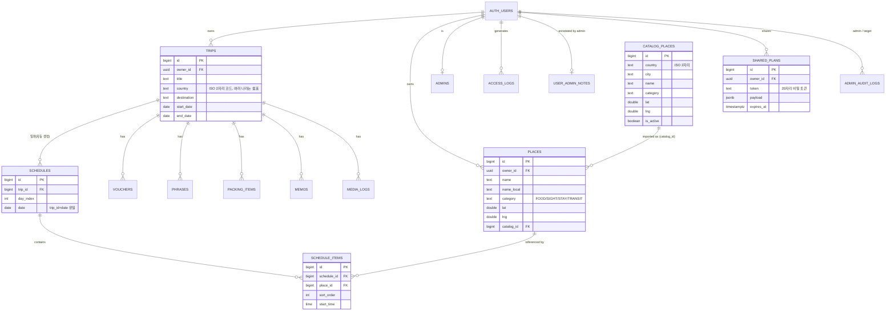

# 02. 데이터베이스 설계

> DBMS: **Supabase(PostgreSQL)** · 스키마: `public` (+ Supabase 기본 `auth.users`)
> 원본 SQL: `supabase/migrations/0001 ~ 0007` — 이 문서는 그 요약이며, **최종 기준은 SQL 파일**입니다.
> 짝 문서: [01 아키텍처](01-시스템-아키텍처.md) · [04 운영 매뉴얼](04-운영-매뉴얼.md)

## 1. 마이그레이션 적용 순서

Supabase 대시보드 → **SQL Editor** 에서 **번호 순서대로** 한 파일씩 실행합니다(모두 `if not exists`/`or replace` 라 다시 실행해도 안전).

| 파일 | 내용 | 필수 |
|------|------|------|
| `0001_init.sql` | 핵심 테이블 9개, 일차 자동 생성 트리거, 일정 교체 함수, RLS | ✅ |
| `0002_admin.sql` | 관리자 목록, 접속 로그, `admin_*` 대시보드·사용자·로그 함수 | 운영 콘솔 사용 시 |
| `0003_admin_users.sql` | 운영자 메모 테이블, 사용자 상세·수정·기간 정지 | 〃 |
| `0004_catalog_insights.sql` | 추천 관광지 카탈로그, 운영 기록(감사), 인사이트 | 〃 |
| `0005_password_ip.sql` | 비밀번호 정책·관리, IP/기기 정보, 변경 요구 | 〃 |
| `0006_place_local_name.sql` | `places.name_local`(현지 이름) | ✅ |
| `0007_shared_plans.sql` | 공유 링크 테이블·함수 | 공유 기능 사용 시 |

> 0007 은 **아직 Supabase 에 적용하지 않았다면 직접 실행해야** 앱의 "공유 링크" 기능이 동작합니다.

## 2. ERD

## 3. 공통 규칙

- 사용자 소유 테이블은 모두 `owner_id uuid not null default auth.uid()` + `references auth.users(id) on delete cascade` → **계정을 삭제하면 그 사용자의 데이터가 함께 삭제**됩니다.
- 기본키는 `bigint generated always as identity`.
- 모든 사용자 테이블에 RLS 를 켜고 정책 `"own rows"`: `owner_id = (select auth.uid())` (읽기·쓰기 모두) — `authenticated` 역할만 접근, **`anon` 권한은 전부 회수**.
- 여행(`trips`)을 지우면 하위 일정·티켓·회화·준비물·메모·사진 기록이 연쇄 삭제됩니다(`on delete cascade`).

## 4. 사용자 데이터 테이블 (0001, 0004, 0006)

### 4-1. `trips` — 여행
| 컬럼 | 타입 | 제약/설명 |
|------|------|-----------|
| id | bigint PK | |
| owner_id | uuid | 소유자 |
| title | text NOT NULL | 여행 이름 |
| country | text NOT NULL | 길이 ≤ 128. 나라 코드(예: `JP`) 또는 여러 나라 `ES,PT` |
| destination | text | 도시·지역 |
| start_date / end_date | date NOT NULL | `end_date >= start_date` |
| created_at | timestamptz | 기본 now() |

- 인덱스: `trips_owner_idx(owner_id)`
- 트리거: `trips_regenerate_schedules` — 생성·기간 변경 시 `regenerate_schedules()` 실행

### 4-2. `schedules` — 일차
| 컬럼 | 타입 | 설명 |
|------|------|------|
| id | bigint PK | |
| trip_id | bigint FK→trips | 연쇄 삭제 |
| day_index | int | 1,2,3… |
| date | date | **`unique(trip_id, date)`** |
| title | text | 기본 "N일차" |

- **직접 만들지 않습니다.** 여행 기간이 바뀌면 트리거가 범위 밖 날짜는 삭제, 새 날짜는 추가, 일차 번호를 다시 매깁니다.
- 인덱스: `schedules_trip_idx(trip_id)`

### 4-3. `places` — 내 장소
| 컬럼 | 타입 | 설명 |
|------|------|------|
| id | bigint PK | |
| name | text NOT NULL | |
| name_local | text | 현지 이름(≤120자, 0006) |
| category | text NOT NULL | 길이 ≤ 32. 앱 값: `FOOD` 맛집, `SIGHT` 관광, `STAY` 숙소, `TRANSIT` 교통 |
| lat / lng | double precision | **null 가능**(위치 없이 이름만 저장한 장소) |
| address / memo | text | |
| catalog_id | bigint FK→catalog_places | 카탈로그에서 가져온 장소 표시 (삭제 시 null) |

- 인덱스: `places_owner_idx`, **유일** `places_owner_catalog_uniq(owner_id, catalog_id) where catalog_id is not null` → 같은 추천 관광지를 두 번 가져오지 않음

### 4-4. `schedule_items` — 하루 일정 항목
| 컬럼 | 타입 | 설명 |
|------|------|------|
| schedule_id | bigint FK→schedules | |
| place_id | bigint FK→places | 장소 삭제 시 항목도 삭제 |
| sort_order | int | 배열 순서 = 표시 순서 |
| start_time | time | 선택 |
| note | text | 메모 |

- 저장은 `replace_schedule_items(schedule_id, items jsonb)` **일괄 교체**(원자적). 인덱스 `schedule_items_sched_idx`

### 4-5. `vouchers` — 티켓/바우처
`trip_id`, `title`, `type`(예: FLIGHT 항공 / HOTEL 호텔 / TICKET 티켓, ≤32자), `body`(내용·예약번호 등). 인덱스 `vouchers_trip_idx`

### 4-6. `phrases` — 회화
`trip_id`, `situation`(상황), `ko`(한국어), `local_text`(현지어), `locale`(음성 언어 코드 예 `ja-JP`, ≤16자). 인덱스 `phrases_trip_idx`

### 4-7. `packing_items` — 준비물
`trip_id`, `name`, `category`(DOCS/CLOTHES/GEAR/TOILETRY/MEDICINE/OTHER), `quantity`(기본 1), `note`, `packed`(챙김 여부), `sort_order`. 인덱스 `packing_trip_idx`

### 4-8. `memos` — 메모(추억)
| 컬럼 | 설명 |
|------|------|
| trip_id | 여행 |
| content | 본문 |
| photo_uri | 기기 내 사진 경로(원본은 서버에 없음) |
| lat / lng | 작성 위치(선택) |
| created_at | `timestamp`(UTC) |
| **client_id** | **앱이 만든 고유값, `unique`** → 오프라인 → 온라인 동기화 시 중복 없이 upsert, 삭제도 이 값으로 |

### 4-9. `media_logs` — 사진/영상 메타데이터
`trip_id`, `local_uri`(기기 경로), `media_type`(≤16), `captured_at`, `lat`, `lng`. **원본 파일은 올리지 않습니다.** 인덱스 `media_logs_trip_idx`

## 5. 카탈로그 (0004)

### 5-1. `catalog_places` — 운영자가 등록하는 추천 관광지
| 컬럼 | 제약 |
|------|------|
| country | `^[A-Z]{2}$` (ISO 코드) NOT NULL |
| city | ≤ 80자 |
| name | 1~120자 NOT NULL |
| name_local | ≤ 120자 |
| category | `FOOD`/`SIGHT`/`STAY`/`TRANSIT` |
| lat / lng | NOT NULL, 위도 −90~90 / 경도 −180~180 |
| address ≤300 / memo ≤2000 | |
| is_active | 기본 true — false 면 사용자에게 숨김 |
| created_by, created_at, updated_at | updated_at 은 트리거(`_touch_updated_at`)가 갱신 |

- **유일** `catalog_places_uniq(country, lower(name), coalesce(lower(city),''))`, 인덱스 `(country, city)`, `(lower(name))`
- RLS: 읽기 = `is_active or is_admin()`(로그인 사용자), 쓰기(추가·수정·삭제) = 관리자만
- 변경 시 트리거(`_audit_catalog`)가 운영 기록에 남김

## 6. 운영 테이블 (0002 ~ 0005)

> 이 테이블들은 **클라이언트에서 직접 읽거나 쓸 수 없습니다**(권한 회수). `admin_*` 함수로만 다룹니다.

| 테이블 | 컬럼(요약) | 설명 |
|--------|-----------|------|
| `admins` | user_id PK→auth.users, created_at | 관리자 목록. 정책 없음 + 권한 회수 |
| `access_logs` | user_id, event(`signup`/`login`/`app_open`/`logout`), platform(≤24), device(≤200), **ip**(요청 헤더 `x-forwarded-for` 첫 값), created_at | 로그인한 본인이 **insert 만** 가능. 인덱스 `(created_at desc)`, `(user_id, created_at desc)` |
| `user_admin_notes` | user_id PK, display_name(≤60), note(≤2000), ban_reason(≤300), updated_at/by, **password_changed_at**, **force_password_change** | 운영자가 사용자에 붙이는 표시 이름·메모·정지 사유(본인은 못 봄), 비밀번호 변경 요구 |
| `admin_audit_logs` | admin_id/email, action, target_user_id/email, detail(jsonb), created_at | 운영 기록(감사). 수정·삭제 불가. 인덱스 `(created_at desc)` |

## 7. 공유 (0007)

### `shared_plans`
| 컬럼 | 설명 |
|------|------|
| owner_id | 보낸 사람 |
| token | 링크의 비밀 토큰. 기본값 = uuid 에서 `-` 제거 후 20자, **unique** |
| title | 계획 제목 |
| payload | **jsonb** 스냅샷(일정·준비물·회화 등). 크기 ≤ 512KB(`octet_length(payload::text) <= 524288`) |
| created_at / expires_at | 기본 만료 **14일** |

- RLS: 보낸 사람(owner)만 생성·조회·삭제. **받는 사람은 테이블을 직접 읽지 못하고** `get_shared_plan(token)` 으로만 읽음(만료 전 + 토큰 일치 1건).

## 8. 함수(RPC) · 트리거

### 8-1. 사용자용
| 이름 | 파일 | 역할 |
|------|------|------|
| `regenerate_schedules()` (트리거) | 0001 | 여행 기간 변경 시 일차 자동 맞춤 |
| `replace_schedule_items(p_schedule_id, p_items jsonb)` | 0001 | 하루 일정 일괄 교체 |
| `import_catalog_place(p_catalog_id)` | 0004/0006 | 카탈로그 → 내 장소 복사(중복 방지, `SECURITY INVOKER`) |
| `catalog_countries(p_include_inactive)` | 0004 | 등록된 나라별 개수 |
| `get_shared_plan(p_token)` | 0007 | 공유 링크 1건 읽기(`SECURITY DEFINER`) |
| `my_password_reset_required()` / `clear_password_change_required()` | 0005 | 임시 비밀번호 사용자의 변경 요구 확인·해제 |
| `is_admin()` | 0002 | 현재 사용자가 관리자인지 |

### 8-2. 운영자용 (`SECURITY DEFINER`, 호출 시 `_require_admin()` 로 관리자 검사)
| 이름 | 역할 |
|------|------|
| `admin_dashboard()` | 가입자·접속자·정지·미인증 수, 일별 그래프(한국 시간) |
| `admin_list_users(...)` / `admin_get_user(id)` | 사용자 목록(검색·필터·IP)과 상세 |
| `admin_update_user(...)` | 이메일·표시 이름·메모·인증 상태 수정 |
| `admin_set_banned(id, banned, ...)` | 기간·사유 지정 정지/해제 |
| `admin_set_admin(id, flag)` | 관리자 지정/해제 |
| `admin_delete_user(id)` | 계정 삭제 |
| `admin_list_logs(...)` | 접속 로그 조회 |
| `admin_list_audit(...)` | 운영 기록 조회 |
| `admin_insights()` | 전환율·시간대·기기·인기 국가/목적지·휴면 통계 |
| `admin_set_password(...)` / `admin_set_force_password_change(...)` / `admin_audit_user_created(...)` | 비밀번호 초기화·직접 지정·변경 요구, 계정 추가 기록 |
| `_check_password(pw, email)` | 비밀번호 정책(8~72자, 영문+숫자, 이메일과 불일치) |
| `_audit(...)` / `_kst_date(ts)` / `_touch_updated_at()` | 내부 도우미 |

> 보안 원칙: 관리자도 다른 사용자의 여행·메모 같은 **내용**은 볼 수 없습니다(RLS 그대로). 계정 정보·집계·로그만 봅니다. `service_role` 키는 쓰지 않습니다.

## 9. 코드 ↔ DB 매핑 (camelCase ↔ snake_case)

`supabaseApi.js` 가 변환합니다. 예: `startDate ↔ start_date`, `localText ↔ local_text`, `nameLocal ↔ name_local`, `catalogId ↔ catalog_id`, `clientId ↔ client_id`.

| 앱 객체 | 테이블 | 비고 |
|---------|--------|------|
| trip / schedule(+items+place) | `trips` / `schedules`+`schedule_items`+`places` | 일정 조회는 3개 조인 |
| voucher / phrase / packing | `vouchers` / `phrases` / `packing_items` | |
| memo / mediaLog | `memos` / `media_logs` | 오프라인 `pending → synced` |
| catalog | `catalog_places` (+ RPC) | 읽기 전용 |
| sharedPlan | `shared_plans` (+ RPC) | |

## 10. 모바일 기기 저장소 (AsyncStorage, DB 아님)

`storage.js` 의 키: 여행·일정·티켓·회화·준비물 캐시, 메모·미디어(`syncStatus`), 환율 캐시(`fxRates`), 장소 소개 캐시(`placeInfo`, 7일), 긴급 연락처(`emergency`). 서버에 저장하지 않는 값입니다.

## 11. 데이터 보관·삭제 정책 권장

| 데이터 | 권장 |
|--------|------|
| `access_logs`(IP 포함) | 90일 이후 삭제: `delete from public.access_logs where created_at < now() - interval '90 days';` |
| `shared_plans` | 만료(14일) 지난 행 주기적 삭제: `delete from public.shared_plans where expires_at < now();` |
| 사용자 삭제 | `admin_delete_user` → 연쇄 삭제(여행·메모 등 전부) |
| 백업 | Supabase 대시보드의 백업/`pg_dump` — [04 운영 매뉴얼](04-운영-매뉴얼.md) 참고 |

## 12. 확장 후보 (미구현)

- **경비 기록**: `expenses(trip_id, amount, currency, category, spent_at, note)` 테이블 + RLS(`owner_id`) 추가.
- 공유 만료 자동 정리: Supabase `pg_cron` 으로 일 1회 삭제.
